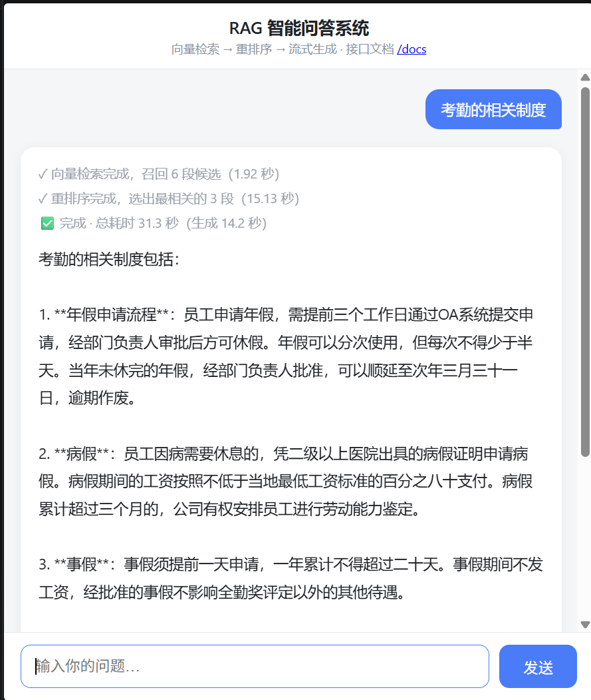

# RAG 智能问答系统

一个从零手写的 **RAG（检索增强生成）** 文档问答系统：把劳动合同知识库的 4 份文档建成向量库，用户提问后经过**两段式检索 + 流式生成**，在网页上像 ChatGPT 一样逐字回答，并展示思考过程与参考来源。



## ✨ 亮点

- 📈 **效果优化记录**：完整的 badcase 拆解文档（现象→定位→方案→验证），见 [docs/优化记录.md](docs/优化记录.md)
- **向量数据库**：chromadb 持久化存储 + HNSW 索引，检索从线性扫描 O(N) 升级到毫秒级近似最近邻
- **两段式检索**：向量粗筛 top-6（保召回率）→ LLM 精排 top-3（保精度），精排用 RankGPT 式打分排序
- **嵌入本地化**：bge-small-zh-v1.5（fastembed + ONNX Runtime，512 维），建库/检索零 API 成本、离线可用
- **流式体验**：FastAPI + SSE 打字机式输出，前端展示思考过程（含每步耗时）、自动滚动、参考来源折叠
- **防幻觉**：提示词约束"只根据资料回答，没有就直说"，验证过"文档里没有的问题"会如实拒绝

## 🏗️ 架构

```
                文档（.md，可多个）
                     ↓ 切块（500字/块，50字重叠）
                本地嵌入 bge-small-zh-v1.5（512维）
                     ↓
              chromadb 向量库（HNSW 索引）
                     ↓
用户问题 → 本地嵌入 → ① 向量粗筛 top-6 → ② LLM 精排 top-3
                     ↓
            glm-4-flash 流式生成 → SSE 推流 → 浏览器打字机输出
```

## 🔄 迭代路线（v1 → v5）

| 版本 | 改动 | 解决的问题 |
|---|---|---|
| v1 | JSON 存向量 + 余弦相似度线性扫描 | 跑通 RAG 最小闭环 |
| v2 | chromadb 向量库 + HNSW | 检索从 O(N) 到毫秒级，支持海量文档 |
| v3 | 两段式检索：向量粗筛 + LLM 精排 | 向量相似度排不准（亲眼见过无关块排第一），重排兜底 |
| v4 | 本地 embedding 替换 API 嵌入 | 嵌入零成本、离线、毫秒级；换模型需全量重建索引 |
| v5 | FastAPI + SSE 网页版 | CLI 变产品：流式输出、思考过程、自动滚动 |

## 🚀 快速开始

```bash
# 1. 安装依赖
.venv\Scripts\python.exe -m pip install -r requirements.txt

# 2. 配置 API key（只有"生成回答"这一步用，检索全本地）
#    把 .env.example 复制为 .env，填入智谱 key：https://open.bigmodel.cn
#    （建库和检索完全离线，不需要 key 也能建库）

# 3. 建库（本地嵌入，秒级完成）
.venv\Scripts\python.exe build_db.py data/样本文档.md data/考勤休假制度.md data/薪酬与绩效考核.md data/劳动合同签订与变更指南.md

# 4. 启动网页
.venv\Scripts\python.exe webapp.py
# 浏览器打开 http://127.0.0.1:8000
# 接口文档自动生成在 http://127.0.0.1:8000/docs
```

命令行版也可以玩（历史版本，用于对照）：

```bash
.venv\Scripts\python.exe ask.py "试用期最长是多久？"        # v1 线性扫描
.venv\Scripts\python.exe ask_db.py "试用期最长是多久？"     # v2 向量数据库
.venv\Scripts\python.exe ask_rerank.py "试用期最长是多久？" # v3/v4 两段式检索 + 本地嵌入
```

## 🧰 技术栈

| 层 | 选型 |
|---|---|
| 嵌入 | BAAI/bge-small-zh-v1.5（fastembed + ONNX Runtime） |
| 向量库 | chromadb（持久化 + HNSW，cosine 空间） |
| 生成 | 智谱 glm-4-flash（OpenAI 兼容接口，流式） |
| Web | FastAPI + SSE + 原生 HTML/JS（无前端框架） |

## 📁 项目结构

```
rag-qa/
  data/                 文档库（换成你自己的 .md 即可）
  rag_lib.py            核心逻辑：切块/嵌入/检索/精排/生成（全部中文注释）
  build_db.py           建库（支持多文档，自动清空重建）
  webapp.py             FastAPI 网页服务（/ask 走 SSE 流式）
  static/index.html     前端：聊天界面 + 思考过程 + 自动滚动
  ask.py / ask_db.py / ask_rerank.py   命令行版 v1/v2/v3（迭代遗迹）
  requirements.txt      依赖清单
  .env.example          API key 模板（.env 已 gitignore，密钥不上传）
```

## ❓ 常见问题

- **端口被占用**：`netstat -ano | grep :8000` 找到占用的 PID，`taskkill //PID xxx //F`；或换个端口改 `webapp.py` 最后一行
- **模型下载慢**：代码里已配置 `HF_ENDPOINT=https://hf-mirror.com`（国内镜像），模型缓存在 `.model_cache/`
- **换自己的文档**：把文件丢进 `data/`，重新 `build_db.py data/你的文档.md`（改库会清空重建）

## 🎯 后续计划

- [ ] 专业重排模型 bge-reranker 替换 LLM 精排
- [ ] PDF 解析（真实业务文档）
- [ ] RAGAS 检索/回答质量评估
- [ ] 多轮对话（上下文记忆）
